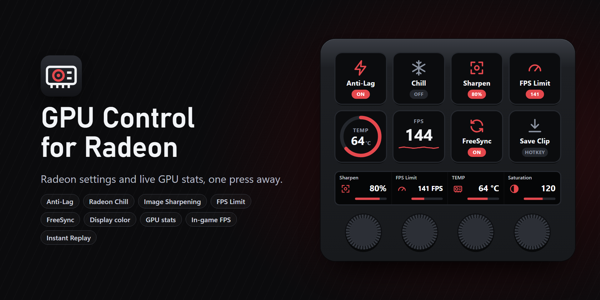
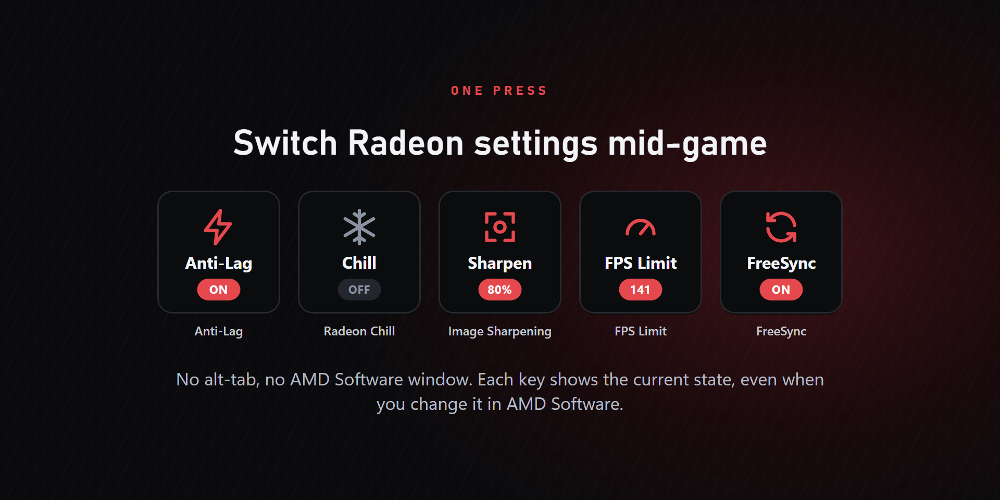
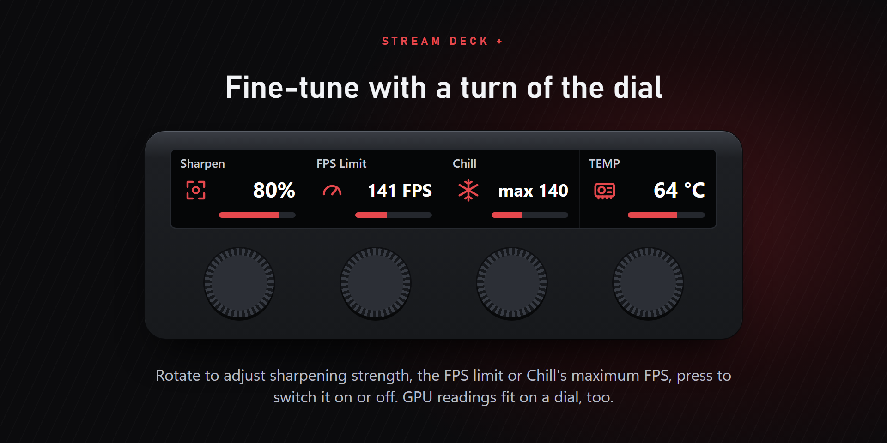
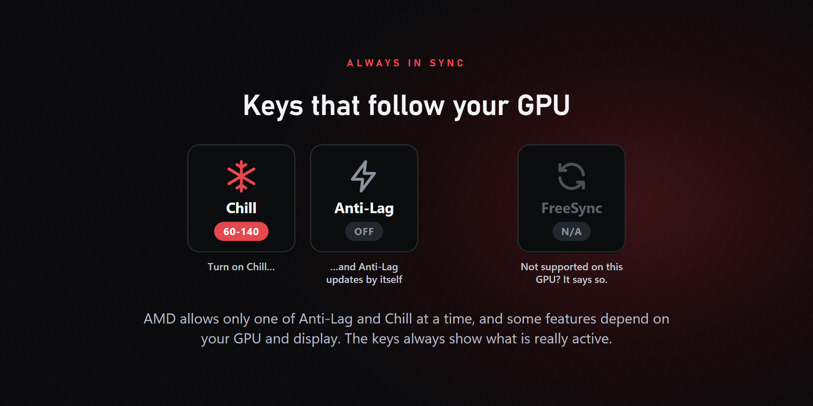
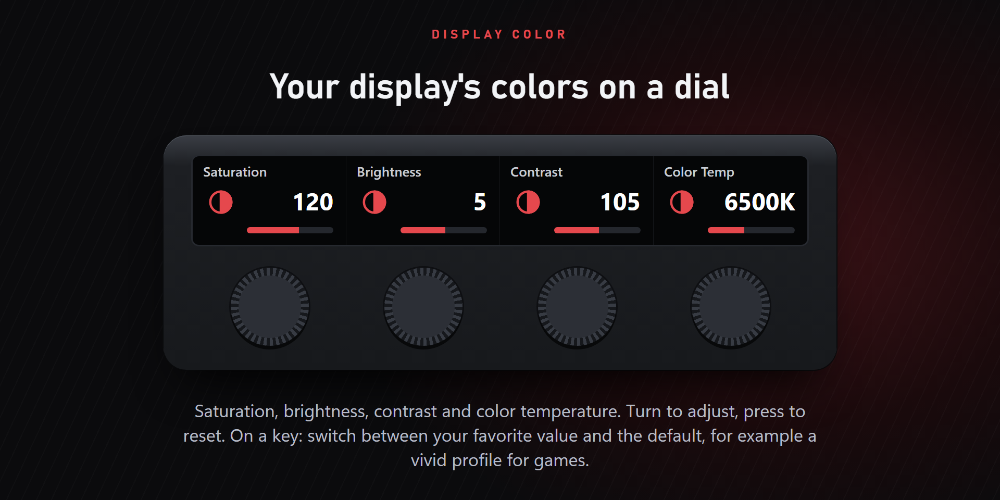
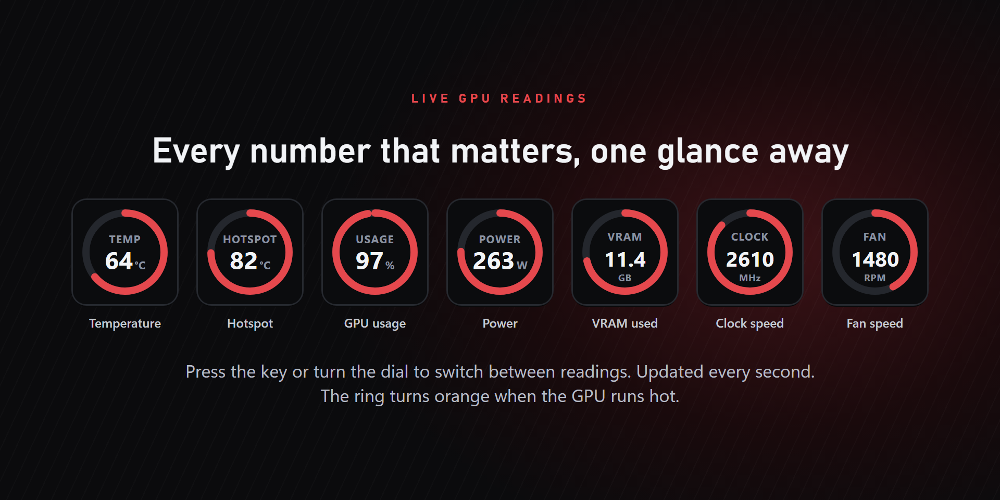
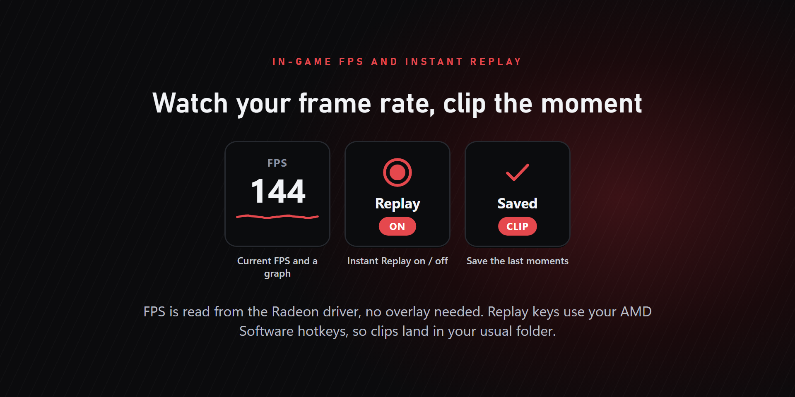

# GPU Control for Radeon for Stream Deck

Switch AMD Radeon settings mid-game from your Stream Deck: Anti-Lag, Radeon Chill, Image Sharpening, FPS Limit, FreeSync and display color. Keep an eye on your GPU with live temperature, usage, power and VRAM readings and in-game FPS, and save Instant Replay clips with one press.

Works on every Stream Deck model with keys. On a Stream Deck +, you can also use the dials and the touch strip.

## Switches
Anti-Lag, Radeon Chill, Image Sharpening, FPS Limit (Frame Rate Target Control) and FreeSync each have their own action.

**On a key**, choose what it does:
- **Toggle on / off**
- **Turn on**
- **Turn off**

The key always shows the current state, also when you change it in AMD Software. Image Sharpening shows its strength, FPS Limit its limit and Chill its FPS range.

**On a dial** (Stream Deck +):
- **Image Sharpening:** rotate to change the strength, press or tap to switch it on or off
- **FPS Limit:** rotate to change the limit, press or tap to switch it on or off
- **Radeon Chill:** rotate to change its maximum FPS, press or tap to switch it on or off

> AMD allows only one of Anti-Lag and Radeon Chill at a time: turning one on turns the other off. Both keys update automatically.

## Display Color
Adjust **saturation**, **brightness**, **contrast** or **color temperature** of a display.
- **Dial:** rotate to adjust, press or tap to reset to the default
- **Key:** switch between your own value (for example saturation 130) and the default

## GPU Status
Shows one GPU reading on a key or on a dial:
- Temperature and hotspot temperature
- GPU usage and power
- VRAM used, clock speed and fan speed

**Key:** press to show the next reading (or set it to do nothing). **Dial:** rotate or press to switch readings.
The ring turns orange above 85 °C. Readings your GPU doesn't report are marked *not available* and skipped.

## FPS, Instant Replay and Save Clip
- **FPS:** the current frame rate of the running game with a graph of the last 30 seconds. Press to toggle the AMD metrics overlay. Shows *no game* when no game is running.
- **Instant Replay:** turns AMD Instant Replay on or off. If Record & Stream is turned off in AMD Software, the key shows *DISABLED*.
- **Save Clip:** saves the last moments recorded by Instant Replay and confirms with *Saved*.

These keys press your AMD Software hotkeys, so clips are saved where AMD Software saves them.

## Settings
- **Key press** (switches): toggle, turn on or turn off
- **Limit to** (FPS Limit key): the FPS to set when the key turns the limit on; `0` keeps the current limit
- **Dial step** (Sharpening, FPS Limit, Chill, Display Color): how much each dial click changes
- **Display** (FreeSync, Display Color): which display to control
- **Adjust** and **Key value** (Display Color)
- **Show** and **Key press** (GPU Status)
- **Adrenalin hotkey** (FPS, Instant Replay, Save Clip): must match the hotkey set in *AMD Software › Settings › Hotkeys*. Pre-filled with `ctrl+shift+o` (Toggle Metrics Overlay), `ctrl+shift+r` (Toggle Instant Replay) and `ctrl+shift+s` (Save Instant Replay); change them if your hotkeys differ

The top of every settings panel shows which GPU the plugin found and tells you when a feature isn't available on your GPU or display. Click **Refresh** after installing a new driver.

## Setup
1. Install a recent **AMD Software: Adrenalin Edition** driver.
2. Drag the actions you want onto keys or dials.
3. For clips: in AMD Software, open **Record & Stream**, turn on **Instant Replay**, and check the hotkeys under **Settings › Hotkeys**.

A key showing **N/A** means your GPU, driver or display doesn't offer that feature (for example FreeSync on a display without FreeSync). A key showing **NO AMD GPU** means the plugin couldn't find an AMD Radeon GPU or driver: install or update AMD Software and click **Refresh**.

## Requirements
- Windows 10 / 11, Stream Deck 6.9 or later
- An AMD Radeon graphics card or Radeon graphics in an AMD Ryzen processor, with a recent AMD Software: Adrenalin Edition driver
- Available features and readings depend on your GPU, driver and display. Some readings, such as power and fan speed, are usually reported only by discrete graphics cards.

Settings are changed through AMD's official library, the same ones you see in AMD Software. No data leaves your computer.

## Release notes

### 1.0.0
- First release: Anti-Lag, Radeon Chill, Image Sharpening, FPS Limit and FreeSync on keys (toggle / on / off) with live state; Stream Deck + dials for sharpening strength, FPS limit and Chill maximum FPS; Display Color (saturation, brightness, contrast, color temperature) on dials and keys; GPU Status (temperature, hotspot, usage, power, VRAM, clock, fan) on keys and dials; in-game FPS with a graph; Instant Replay and Save Clip.

## Support
Open an issue on this page.

## License
Copyright © 2026 NiQzen. All rights reserved. Use of the plugin is governed by the end user license agreement in [LICENSE](LICENSE).

AMD, Radeon, FreeSync, Radeon Chill and Radeon Anti-Lag are trademarks of Advanced Micro Devices, Inc. This plugin is not affiliated with, sponsored or endorsed by AMD. Stream Deck and Elgato are trademarks of Corsair Memory, Inc.
